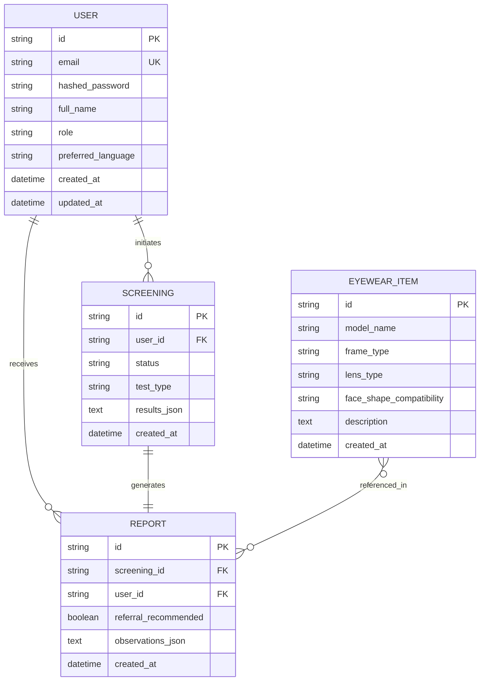

# OptiGuide — Database Design & Schema Architecture

## 1. Overview
OptiGuide uses SQLAlchemy 2.0 with Alembic migrations. It targets **PostgreSQL** in production/staging environments and supports **SQLite** for zero-dependency local development and CI testing.

---

## 2. Entity-Relationship Model (Phase 1 Baseline & Phase 2 Schema)

---

## 3. Storage Strategy & Abstraction

All database queries are decoupled behind repository patterns. Route handlers never execute raw SQL directly, and all models inherit from `backend.app.database.base.Base`.
