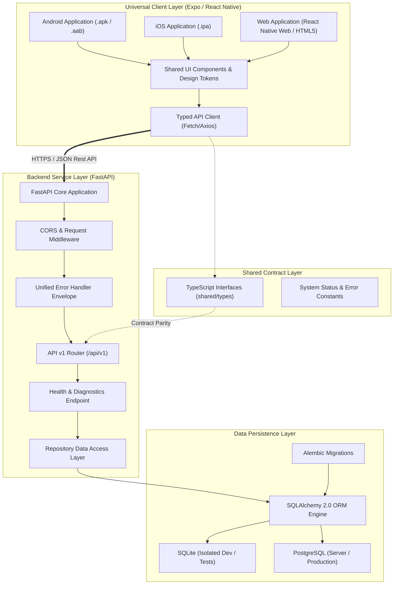

# OptiGuide — Phase 1 System Architecture Specification

## 1. System Overview

OptiGuide is a production-oriented, cross-platform preliminary vision screening and eyewear guidance platform. It provides initial screening tools, acuity indicators, and ergonomic eyewear guidance. 

> [!IMPORTANT]
> **Clinical Disclaimer:** OptiGuide is strictly a preliminary screening and eyewear guidance platform. It is not a diagnostic device and does not prescribe corrective lenses or make clinical diagnoses. All findings require confirmation by licensed eye-care professionals (optometrists/ophthalmologists).

Phase 1 establishes the unified monorepo, robust cross-platform mobile/web client foundations, modular backend micro-architecture, type-safe API contracts, database migration workflows, and automated continuous integration.

---

## 2. Component Architecture Diagram

---

## 3. Directory Responsibilities

| Path | Primary Responsibility | Isolation Boundary |
| :--- | :--- | :--- |
| `apps/mobile/` | Universal Expo application targeting Android, iOS, and Web. Houses UI screens, design tokens, navigation, and API service integration. | Client-side only. Zero backend database access or server secrets. |
| `backend/` | FastAPI server application. Encapsulates business logic, database models, Alembic migrations, Pydantic schemas, and REST endpoints. | Server-side only. Direct access to DB and internal services. |
| `shared/` | Shared TypeScript interfaces and constant definitions common to client and server contracts. | No dependencies on React or FastAPI. Pure TypeScript/JSON. |
| `docs/` | Authoritative engineering documentation, repository audits, architecture blueprints, API contracts, security guidelines, and test matrices. | Documentation and technical specifications. |
| `.github/` | CI/CD automation pipelines for automated linting, typechecking, testing, and production builds. | Automation and release gates. |

---

## 4. Frontend Technology Decisions

1. **Expo SDK (v52) with React Native:**
   - Provides first-class universal support across Android, iOS, and Web.
   - Eliminates platform divergence in UI tokens and core business logic.
2. **React Native Web:**
   - Compiles standard React Native components (`View`, `Text`, `Pressable`) directly into accessible HTML5/DOM elements.
   - Web application can be exported statically (`npx expo export -p web`) or served via Node/CDN.
3. **Navigation Strategy:**
   - Native Stack Navigation pattern using robust React Native primitives. Designed to seamlessly upgrade to Expo Router or React Navigation Stack as screens expand.
4. **Design Tokens & Theming:**
   - Centralized theme tokens in `apps/mobile/src/theme/tokens.ts` defining color palettes (Primary Blue, Medical Teal, Neutral Slate, Semantic Status), typography scales, spacing units (4px grid), border radii, and cross-platform shadows/elevation.

---

## 5. Backend Micro-Architecture

1. **FastAPI Application Factory:**
   - Centralized configuration via `pydantic-settings` (`Settings` class) reading from environment variables with strong typing.
   - Structured logging interceptor ensuring zero sensitive credentials or PII are logged.
2. **Database Abstraction & Multi-Engine Support:**
   - SQLAlchemy 2.0 declarative models and engine pooling.
   - **PostgreSQL** via `psycopg` driver for server deployment.
   - **SQLite** (`sqlite:///...`) with foreign key enforcement for isolated local development and deterministic CI unit tests.
   - Database operations wrapped inside repository patterns and connection health checks.
3. **Alembic Migration System:**
   - Fully configured `alembic.ini` and `migrations/env.py` detecting SQLAlchemy metadata changes for automated schema generation and rollback capabilities.
4. **Standardized Response Envelope:**
   - Standard `/health` and `/api/v1/health` providing service metadata and isolated database connectivity status.
   - Unified error envelope (`{ "error": { "code": "...", "message": "...", "details": [...] } }`) across 400, 404, 422, 500, and 503 statuses.

---

## 6. Request Flow Lifecycle

1. **Client Request:** Mobile or Web client initiates an HTTP request using `apps/mobile/src/services/apiClient.ts`.
2. **CORS & Middleware Inspection:** FastAPI middleware inspects the origin header against `CORS_ORIGINS`.
3. **Routing & Authentication Boundary:** Request routed via `/api/v1/` sub-routers.
4. **Validation:** Pydantic v2 validates request headers, query parameters, and payload bodies.
5. **Service & Repository Execution:** Service handles business logic and invokes repository for database transactions.
6. **Error Interception:** Any unhandled exception is caught by global exception handlers and translated into the standard JSON error envelope without exposing stack traces.
7. **Client Rendering:** Client maps the response to TypeScript interfaces defined in `shared/types/api.ts`.
